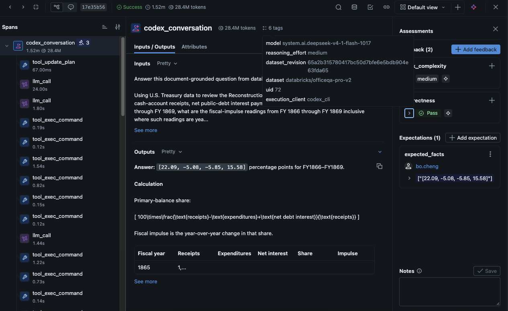

# Databricks Tokenomics

Track and analyze the **token economics** of GenAI workloads on Databricks — the
token consumption, cost (DBU / dollars), and efficiency of model-serving,
Foundation Model APIs, and agent workloads — so you can attribute spend, spot
regressions, and optimize prompts and models.

> **Status:** starter scaffold. Sections marked _TODO_ are placeholders to fill in
> as the project takes shape.

## What you get

_TODO — describe the deliverable._ For example:

- **Usage ingestion** — pull token/usage and billing data (e.g. `system.billing.usage`,
  model-serving logs, MLflow traces) into Unity Catalog tables.
- **Cost attribution** — join usage to workloads, teams, and use cases to answer
  "who spent what, on which model, for which feature."
- **Dashboards & alerts** — AI/BI dashboards and thresholds for spend and token trends.

## OfficeQA benchmark results

In our OfficeQA Pro v2 benchmark, DeepSeek V4.1 Flash 1017 answered **51 of 90
questions correctly (56.7%)**, compared with **49 of 90 (54.4%)** for GPT-6.1 Sol.
Estimated inference costs were **$9.55 versus $12.92**, making DeepSeek **26.1%
less expensive per question** using a $0.07-per-DBU conversion and the rate cards
captured for the October 29, 2026 analysis. The open-weight model consumed more
tokens in this run, but its lower pricing and extensive cache usage kept costs
below GPT's. The two-question accuracy gap and differing reasoning settings do
not establish a definitive winner. Costs exclude evaluation judges, failed
attempts, and other compute.

### Accuracy and cost comparison

The comparison summarizes correctness and estimated costs overall and by task
complexity, distinguishing total spend divided by correct answers from the
average inference cost of questions answered correctly.


### Estimated cost savings

DeepSeek's estimated average cost was $0.1061 per question versus $0.1436 for
GPT-6.1 Sol, a savings of approximately $0.0375 per question.


### Inspecting a benchmark trace

An MLflow trace brings the generated answer, tool calls, model and dataset tags,
and correctness and task-complexity assessments into one view.



### Token and cache accounting

The usage breakdown separates input, output, cache-read, and cache-write tokens
so costs can be attributed to the appropriate pricing categories.


### Evaluating answer quality

The assessment panel records the task-complexity label and the correctness
judge's rationale alongside the answer, making individual results inspectable.


## Prerequisites

- A Databricks workspace with Unity Catalog and access to the relevant billing /
  usage system tables and model-serving endpoints.
- The [Databricks CLI](https://docs.databricks.com/dev-tools/cli/) (`databricks`)
  authenticated to that workspace.
- [`uv`](https://docs.astral.sh/uv/) installed (for Python tooling).

```bash
# Authenticate the CLI (creates a profile you'll select later)
databricks auth login --profile my-workspace
```

> Never auto-select a profile — always pass `--profile <name>` explicitly.

## Setup

_TODO — replace with the real setup steps once the project has an entry point._

```bash
# Clone and install
git clone https://github.com/bcheng004/databricks-tokenomics.git
cd databricks-tokenomics
uv sync
```

## MLflow tracing for Codex

MLflow can capture each Codex conversation turn, including prompts, responses,
tool calls, token usage, and Git metadata. The integration uses a Codex `notify`
hook and requires Codex CLI and Node.js 18 or newer.

Install the integration:

```bash
npm install -g @mlflow/codex
```

Authenticate to Databricks with an explicitly named profile, then run setup from
the repository root:

```bash
databricks auth login --profile <profile-name>
mlflow-codex setup
```

Choose the project-level `./.codex/` location when prompted. For Databricks,
enter `databricks://<profile-name>` as the tracking URI and the ID of the MLflow
experiment that should receive the traces. Never omit the profile name or rely
on a default Databricks profile.

Setup creates these files:

- `.codex/config.toml`, which registers the hook:

  ```toml
  notify = ["mlflow-codex", "notify-hook"]
  ```

- `.codex/mlflow-tracing.json`, which stores the tracing destination:

  ```json
  {
    "trackingUri": "databricks://<profile-name>",
    "experimentId": "<experiment-id>"
  }
  ```

### Store traces in Unity Catalog

For Unity Catalog-backed traces, the tracking URI and experiment ID are not
enough. Add `traceLocation` to `.codex/mlflow-tracing.json` (or run
`uv run setup-mlflow-uc-experiment` from the repository root, which provisions
a new experiment and UC location and writes this file for you). It prompts for
an experiment name and a new schema name. The experiment is created directly
under `/Shared`, such as `/Shared/codex-traces`, and the schema is created in the
selected catalog. Use `--experiment-name codex-traces --schema codex_traces_v2`
or the `EXPERIMENT_NAME` and `UC_SCHEMA` environment variables for a
non-interactive run. The command fails if either object already exists rather
than silently reusing it:

```json
{
  "trackingUri": "databricks://<profile-name>",
  "experimentId": "<experiment-id>",
  "traceLocation": "<catalog>.<schema>.<table-prefix>"
}
```

The UC trace location must already be provisioned in the workspace, and the
authenticated user must be able to write to it. The value is a three-part table
prefix, not the name of only the spans table. For example, a prefix of
`my_catalog.observability.codex` routes the integration to the UC trace tables
associated with that prefix, such as `codex_otel_spans`.

Restart Codex after changing its configuration, then complete a turn and check
the experiment's **Traces** tab or the configured UC trace view. If tracing does
not appear, verify that `mlflow-codex` is on `PATH`, the Databricks profile is
authenticated, and the experiment and UC location exist and are accessible.

See the [official MLflow Codex tracing guide](https://mlflow.org/docs/latest/genai/tracing/integrations/listing/codex/)
for additional configuration and troubleshooting details.

## Run OfficeQA Pro v2

Accept the gated dataset's access conditions on Hugging Face and set `HF_TOKEN`
in your gitignored `.env` file. Install dependencies with `uv sync`.

Run one question first to verify the configured MLflow destination:

```bash
uv run run-officeqa --profile <profile-name> --warehouse-id <warehouse-id> \
  --output-dir results/officeqa-pro-v2-gpt-6-1-sol --limit 1
```

Then run all questions; the completed smoke-test question is skipped:

```bash
uv run run-officeqa --profile <profile-name> --warehouse-id <warehouse-id> \
  --output-dir results/officeqa-pro-v2-gpt-6-1-sol --workers 2
```

The profile must match `.codex/mlflow-tracing.json`. The warehouse is used to
query and verify Unity Catalog-backed traces; it can also be configured through
`MLFLOW_TRACING_SQL_WAREHOUSE_ID` in the environment or `.env`.

The runner downloads a pinned full dataset snapshot (including PDFs and parsed
JSON) into `data/officeqa-pro-v2/`. It converts the entire parsed corpus into
searchable text in `results/officeqa-pro-v2/workspace/corpus/`. Each question gets
an independent, read-only Codex session. Prompts include only the question and
UID, not reference answers or annotated source-document hints. The runner explicitly
passes `--model system.ai.gpt-6-1-sol` by default rather than relying on Codex's
model default. These sessions preserve provider and reasoning settings from the
user's Codex config, excluding MCP servers and plugins; the agent is instructed
to use only the local corpus.
The runner explicitly disables Codex's hosted web-search tool so it is not sent
to providers that do not support it.
This is prompt-level answer-key separation, not an OS-level filesystem boundary.

Use `--reasoning-effort high` to set Codex's `model_reasoning_effort` explicitly.
Supported effort levels depend on the model and Codex client. When omitted, the
runner inherits the top-level effort setting from `$CODEX_HOME/config.toml`
(`~/.codex/config.toml` by default). If none is configured, it records `default`,
meaning no effort override was sent, not a measured or inferred effort level.
Passing `--reasoning-effort default` explicitly ignores an inherited override.
The setting is resolved once per batch and recorded in the manifest, question
results, summary, and trace tag `reasoning_effort`. It is separate from the
OpenJev `task_complexity` assessment and does not automatically route questions.

After each completed question, the runner exports that session through
`mlflow-codex` exactly once, then adds and reads back the trace tags `uid`,
`dataset` (the Hugging Face repository name), `dataset_revision`, `model`, `reasoning_effort`, and
`execution_client=codex_cli`. It verifies that the trace contains LLM spans.
The runner uses a repository-local adapter around the installed `mlflow-codex`
exporter to attach the full question's Codex-reported usage to the root span as
structured `mlflow.chat.tokenUsage`. It records `input_tokens`, `output_tokens`,
and `total_tokens`, plus `cache_read_input_tokens` (from Codex's
`cached_input_tokens`) and `cache_creation_input_tokens` (from
`cache_write_input_tokens`) when reported. Missing cache counts remain absent;
reported zeros are preserved. Cached input is already included in input tokens,
so total tokens are input plus output without adding cached tokens again. The
runner verifies the root span attribute and MLflow's aggregated
`mlflow.trace.tokenUsage` metadata after export. The adapter requires Node.js
and the installed `@mlflow/codex` package; it does not modify the global
installation. Existing completed traces are skipped rather than backfilled.
Automatic notify export is disabled only for
these child sessions to avoid duplicate traces; the project's hook is unchanged.

Answers, Codex events, export logs, and trace IDs are kept under
`results/officeqa-pro-v2/questions/<uid>/`; `summary.json` records batch status
and token usage reported by Codex. Both `data/` and `results/` are gitignored.
Re-running the same command resumes completed agent executions and skips
completed traces. Ambiguous exports and interrupted agent sessions fail rather
than silently duplicating executions; inspect their logs before retrying. Use
`--resume-failed` to continue interrupted Codex sessions in place, preserving
earlier attempt logs. Reduce `--workers` if the model gateway returns rate limits.
HTTP 429 failures are retried twice in the same session after 60 and 120 seconds
(configurable with `--rate-limit-retries` and `--retry-delay`). Persistent rate
limits stop queued questions instead of repeatedly sending more requests.

Use `--uid <uid>` to select a question, `--model <model>` to override the pinned
model, or `--download-only` to fetch data without inference. Use a separate
`--output-dir` for each model/effort batch; the manifest rejects mismatched models
or effort settings so existing results cannot silently be reused. Directories
created before effort tracking also require a new `--output-dir`; historical
runs are not relabeled using today's config. For example, use
`--reasoning-effort high --output-dir results/officeqa-pro-v2-gpt-6-1-sol-high`.
To reuse a
completed download without network checks, pass `--skip-download --revision
<snapshot-commit-sha>`. Never commit the token or downloaded answer keys.

### Score existing OfficeQA answers

Use the built-in MLflow `Correctness` scorer without regenerating answers:

```bash
uv sync --extra evaluation
uv run --extra evaluation score-officeqa --profile <profile-name> \
  --warehouse-id <warehouse-id> --revision <snapshot-commit-sha> --limit 3
uv run --extra evaluation score-officeqa --profile <profile-name> \
  --warehouse-id <warehouse-id> --revision <snapshot-commit-sha>
```

The evaluator selects successful traces tagged with the dataset and
`execution_client=codex_cli`, matches each trace's `uid` to the CSV, and supplies
the complete `answer` as `expectations={"expected_facts": [answer]}`. It validates
the dataset revision and rejects unknown UIDs. The revision can be read from
`snapshot.json` when available, or passed explicitly with `--revision` using the
commit in the question batch's manifest. Both model batches are included
by default; use `--model <answer-model>` to filter a batch and a separate
`--output-dir` for a different selection or judge.

To score only the latest successful trace for each UID across model batches, add
`--latest-per-uid` and use a separate `--output-dir`, such as
`results/officeqa-correctness-opus-5-5-latest`. Selection uses the trace start time
and happens before checkpoint skipping or `--limit`, so older attempts are not
scored when the latest attempt already has an assessment.

The judge is explicitly pinned to
`--judge-model databricks:/databricks-claude-opus-5-5` (Claude Opus 5.5), not the
answer-generation model or an automatically selected judge. Another judge can be selected with
`--judge-model <provider>:/<model-name>` (additional provider dependencies may be
needed). Standard `mlflow.genai.evaluate()` attaches `expected_facts` and
`correctness` assessments, including the judge rationale, to the existing
Unity Catalog traces. Evaluation runs and metrics are logged to the configured
experiment. Assessment verification checks the judge's recorded source model.
Verified Opus results are checkpointed separately from earlier default-judge tests in
`results/officeqa-correctness-opus-5-5/summary.json` and skipped on subsequent invocations.
Errors are not counted as incorrect answers and are eligible for retry.
If the native judge parser rejects prose before a JSON verdict, a strict fallback
accepts only one trailing JSON object with a `yes`/`no` result and nonempty
rationale. The original model response and parser-recovery version are preserved
in assessment metadata. Ambiguous or malformed responses remain errors. Rerun
the same command and output directory to retry only unfinished assessments;
completed scores are retained, and new scores are verified on the original root
spans with the selected judge model and evaluation run.

### Classify question difficulty with OpenJev

`classify-officeqa` assigns one question-only `task_complexity` assessment to the
latest successful trace for each selected UID. It uses the OpenJev System One
`choice` API, not Codex's Responses API, and does not regenerate or grade answers.

The versioned rubric is:

- **trivial**: one explicit fact lookup, without calculation or reconciliation.
- **low**: a few lookups and basic arithmetic or a simple aggregation.
- **medium**: multi-step retrieval or calculation, combining tables or periods,
  standard analytics, or unit normalization.
- **high**: advanced mathematics/statistics, nontrivial algorithms, or extensive
  cross-source reconciliation and entity harmonization.

Only the question is sent for classification: no generated answers, reference
answers, correctness scores, or observed token usage. These labels estimate task
difficulty under this rubric, not measured effort or routing guarantees.

Smoke-test three questions with an explicitly selected Databricks profile that
can execute the OpenJev model service:

```bash
uv run --extra evaluation classify-officeqa --profile <profile-name> \
  --warehouse-id <warehouse-id> --revision <snapshot-commit-sha> --limit 3
```

The default model is `system.ai.openjev-qwen35-4b`; override it with `--model`.
Use repeated `--uid` flags to select particular tasks. Omitting `--limit`
classifies all remaining latest traces; this is a separate, potentially billable
run. Verified assessments with the same model and rubric are skipped on reruns.
Use `--answer-model <model-name>` to classify only traces tagged with a particular
answer-generation model; `--model` still selects the OpenJev judge.
Results are saved in `results/officeqa-task-complexity/summary.json`; labels,
model confidence, and all four label probabilities are attached to the original
trace's root span. Confidence is the model's reported value, not calibrated
accuracy. Changing the model, rubric, dataset, or destination requires a separate
`--output-dir`. No endpoint deployment is needed; the selected workspace must
already have a System One-compatible model service and permission to execute it.

## Project structure

_TODO — update as the layout is created._

```
databricks-tokenomics/
├── AGENTS.md          # Instructions for AI coding agents
├── README.md          # This file
├── pyproject.toml     # Project metadata and dependencies (uv)
├── .gitignore
├── scripts/           # Standalone `uv run` scripts (PEP 723 inline dependencies)
└── ...
```

## Configuration

_TODO — document the environment variables / bundle variables the project reads._

Copy `.env.example` to `.env` and fill in the values (do not commit `.env`).

## Concepts

- **Token** — the unit of input/output consumed by an LLM request; the basis for
  most GenAI billing on Databricks.
- **Tokenomics** — the accounting and optimization of token usage and its cost
  (tokens → DBUs → dollars) across models, endpoints, and workloads.
- **Attribution** — mapping usage back to a team, use case, or feature so spend
  is explainable and actionable.

## References

- [Databricks CLI](https://docs.databricks.com/dev-tools/cli/)
- [System tables: billing usage](https://docs.databricks.com/admin/system-tables/billing.html)
- [Model Serving](https://docs.databricks.com/machine-learning/model-serving/index.html)
- [Foundation Model APIs](https://docs.databricks.com/machine-learning/foundation-models/index.html)
- [MLflow tracing](https://mlflow.org/docs/latest/tracing/)
